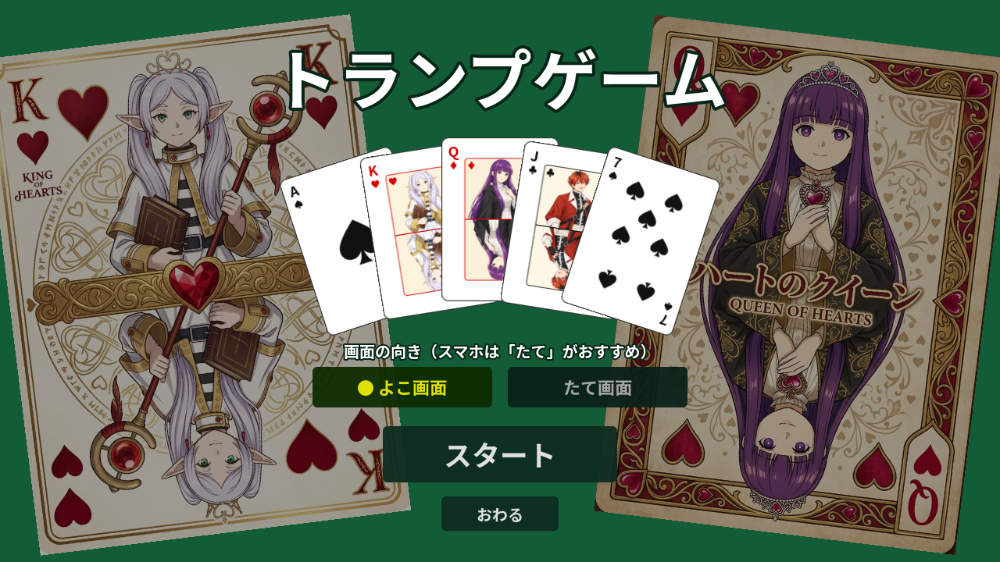
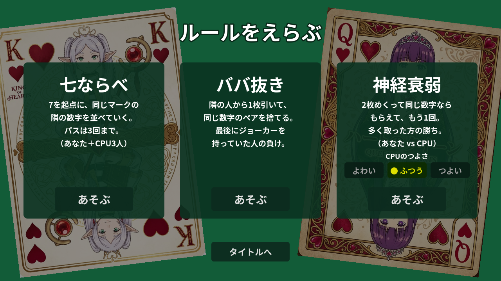
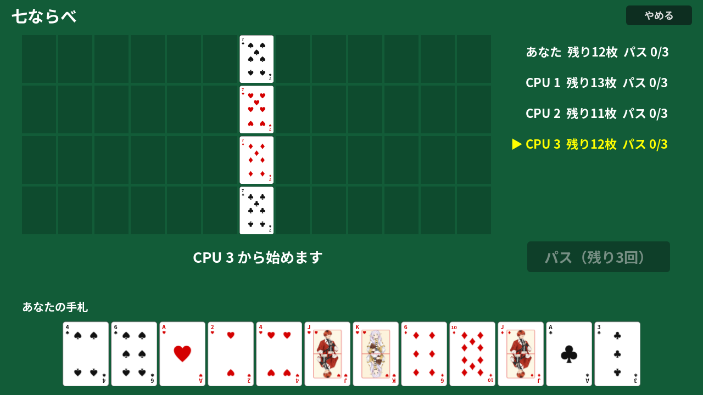
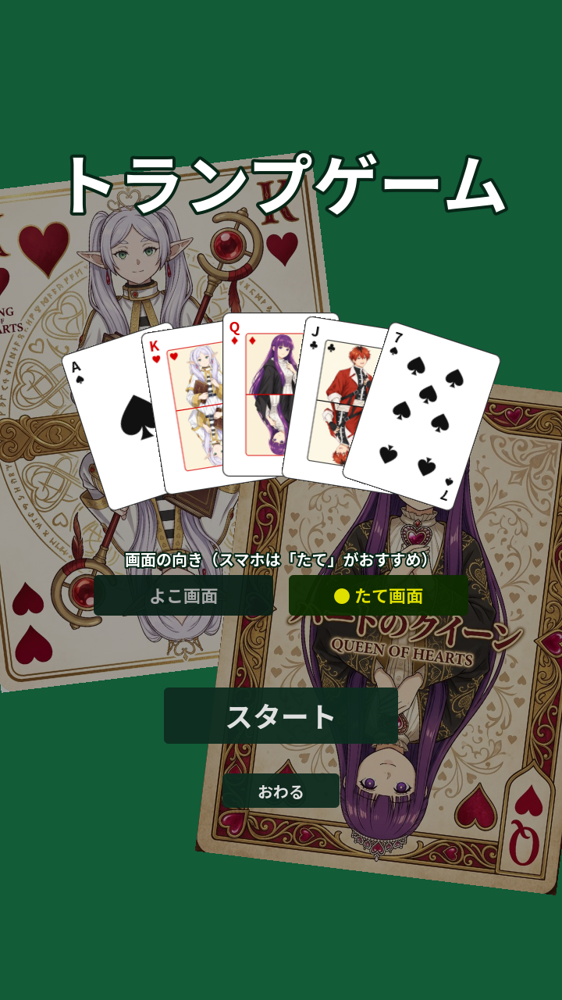

# Frieren Playing Card（トランプゲーム）

Godot 4 で作った、ブラウザで遊べるトランプゲーム集です。
七ならべ・ババ抜き・神経衰弱を、CPU を相手に 1 人で遊べます。

**itch.io で公開中 → https://project-create-games.itch.io/frieren-playing-card**



| ルール選択 | 七ならべ | たて画面 |
|---|---|---|
|  |  |  |

## 遊べるゲーム

| ゲーム | 人数 | ルール |
|---|---|---|
| 七ならべ | あなた + CPU 3 人 | 7 を起点に、同じマークの隣の数字を並べる。パスは 3 回まで。出せずにパスも使い切ると脱落 |
| ババ抜き | あなた + CPU 3 人 | 隣の人から 1 枚引き、同じ数字のペアを捨てる。最後にジョーカーを持っていた人の負け |
| 神経衰弱 | あなた vs CPU | 2 枚めくって同じ数字なら取れて、もう 1 回。CPU のつよさは「よわい / ふつう / つよい」から選べる |

画面の流れは **タイトル → ルール選択 → ゲーム → 結果 → ルール選択** です。

## 特徴

- **ブラウザでそのまま遊べる**：インストール不要。PWA 対応なので、ほしい人はホーム画面に追加できます。
- **よこ画面 / たて画面**：タイトルで切り替え。スマホは「たて画面」がおすすめです（最初は画面の形から自動で選びます）。
- **タップ / クリックだけで操作**：PC でもスマホでも同じように遊べます。

## 開発

### 必要なもの

- [Godot 4.6](https://godotengine.org/)（Compatibility レンダラー）
- Web 書き出しをする場合は、Godot 4.6 のエクスポートテンプレート

### 動かす

Godot 4.6 のエディタでこのフォルダを開いて実行するか、コマンドで起動します。

```bash
godot --path .
```

たて画面で起動して確認したいときは、引数を付けます。

```bash
godot --path . -- --portrait
```

### Web 用に書き出す

```bash
godot --headless --path . --export-release "Web" build/web/index.html
```

`build/web` に出力されます（Git の管理対象外）。手元で確認するときは、簡易サーバーを立ててブラウザで開きます。

```bash
python -m http.server 8060 --directory build/web
```

書き出し直したあとに古い画面が出るときは、PWA のキャッシュが残っています。強制再読み込み（Ctrl+Shift+R）か、サイトデータの削除をしてください。

### フォルダ構成

| 場所 | 内容 |
|---|---|
| `scenes/` | 各画面のシーン（中身はスクリプトで組み立て） |
| `scripts/title.gd` / `rule_select.gd` | タイトル、ルール選択 |
| `scripts/sevens.gd` / `old_maid.gd` / `memory.gd` | 各ゲーム |
| `scripts/game_base.gd` | ゲーム共通の土台（メッセージ、結果表示、ルール選択へ戻る） |
| `scripts/card.gd` / `card_view.gd` | カードのデータと見た目 |
| `scripts/ui.gd` / `settings.gd` | UI の部品、画面の向きや CPU のつよさなどの設定 |
| `assets/cards/` | カードの SVG（52 枚 + ジョーカー + 裏面） |
| `assets/images/` | タイトルとルール選択の背景に使うカード絵 |
| `tools/make_icon.gd` | アプリアイコンを作り直すスクリプト |

### ゲームを追加するには

1. `GameBase` を継承したスクリプトとシーンを作る（`setup_base()` で土台を作り、終わったら `show_result()` を呼ぶ）。
2. `scripts/rule_select.gd` の `RULES` に 1 行足す。

これでルール選択に並び、結果表示とルール選択への戻りはそのまま使えます。

## 作ってみて

- **カードを作るのは少し手間取った**：絵柄の画像生成と、カード 1 枚ずつの SVG 生成に時間がかかった。
- **ゲームのソースは指示だけで構築できた**：[Claude Code](https://claude.com/claude-code) に日本語で指示して作り、手での修正箇所はなし。
- **SVG の文字は Godot では描かれない**：Godot の SVG 読み込みは `<text>` を描画しないので、カード隅の数字はゲーム側で描き足している。フォントを足しても直らないので、最初は原因が分かりにくかった。
- **Web ではフォントの同梱が必要**：ブラウザ版は PC に入っているフォントを使えないため、Noto Sans JP を同梱した。
- **エクスポートテンプレートのバージョン違いでつまずいた**：エディタとテンプレートのバージョンが合っていないと、ブラウザで「pck が読めない」というエラーになる。最終的に Godot 4.6 にそろえて書き出した。
- **スマホ向けには、たて画面の配置を別に用意した**：よこ画面のまま縮めるとカードの数字が読めないので、七ならべはマークごとの縦列に重ねる形にするなど、ゲームごとに並べ方を変えている。

## ライセンス

- **ソースコード**：[MIT License](LICENSE)
- **フォント**：[Noto Sans JP](https://fonts.google.com/noto/specimen/Noto+Sans+JP) は SIL Open Font License 1.1（`assets/fonts/Noto_Sans_JP/OFL.txt`）
- **カードの絵柄**：『葬送のフリーレン』のキャラクターを題材にしたファンアートで、MIT License の対象外です。作品とキャラクターの権利は各権利者に帰属します。
